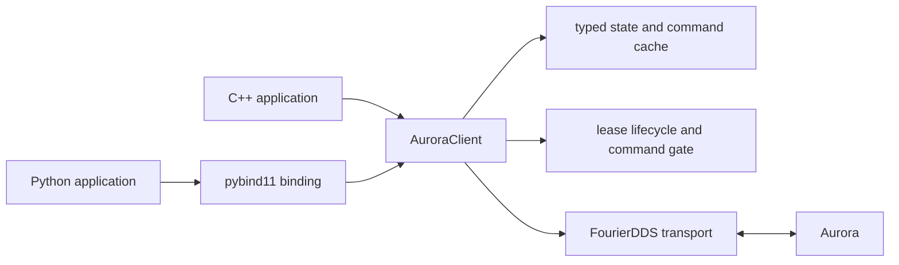

# SDK Overview and Build Guide

[中文](overview_CN.md) · [Quick start](../README.md) ·
[C++ API](cpp_api.md) · [Python API](python_api.md) ·
[Examples and clients](examples_and_clients.md)

## What the SDK provides

Fourier Aurora SDK is one client implementation with two language surfaces:

- a C++17 shared library in namespace `fourier::aurora_sdk`;
- a Python package, `fourier_aurora_client`, bound to the same C++ core with
  pybind11.

The high-level `AuroraClient` owns DDS endpoint creation, lifecycle, received
state caches, service calls, command publication, and the module's control
lease. C++ and Python therefore follow the same lifecycle and result model.



Generated DDS types and transport details are implementation dependencies.
Application code should include `aurora_client.hpp` or import
`fourier_aurora_client`, and should use SDK-owned commands, states, results,
and exceptions.

## Repository layout

| Path | Purpose |
|---|---|
| `include/fourier_aurora_sdk/` | Installed C++ headers and SDK-owned types |
| `src/` | C++ client, lease manager, and FourierDDS transport implementation |
| `python/bindings/` | pybind11 bindings for the C++ API and data types |
| `python/fourier_aurora_client/` | Pythonic singleton wrapper and package exports |
| `examples/client/` | Robot-independent C++ diagnostic clients |
| `examples/gr3/` | Standalone C++ and Python GR3 recipes |
| `tests/` | C++, Python, DDS loopback, and installed-package tests |
| `scripts/` | Build, package, and verification entry points |
| `packaging/`, `cmake/` | Debian and CMake package support |
| `docs/` | Bilingual user documentation |
| `docs/internal/` | Maintainer-only ADRs, contracts, and release records |
| `VERSION`, `REVISIONS.yaml` | SDK version and compatible dependency revisions |

## Runtime design

### One restartable client per process

`AuroraClient` is a process-wide singleton. Getting the instance does not start
DDS. Configure it while `Stopped`, call `start()`, perform operations, and call
`stop()` before shutdown. After `stop()` it may be configured and started again.

`config()` returns a copy. `configure()` replaces the entire option set, so the
usual pattern is to copy the current configuration, edit the fields needed by
the application, and write the complete object back.

### Selective endpoints

`ConnectionOptions.enabled_endpoints` controls which DDS readers, writers, and
services are created. Selecting only required endpoints reduces discovery and
resource use. `waitForEndpoints()` / `wait_for_endpoints()` waits until every
enabled endpoint is matched, then adds a 200 ms stabilization delay for the
first volatile samples.

SDK-managed upper-interface topic and service names use
`ConnectionOptions.topic_prefix`, which defaults to `aurora/`. For example,
the defaults produce `aurora/robot_motion_cmd` and `aurora/ManageLease`. Set
the option to an empty string when Aurora is configured without a prefix.

Every SDK client requires a `source_name` matching
`[A-Za-z0-9._-]{1,64}` before transport startup. Protected publishers
(`MotionCommand`, `ControlGroupCommand`, and temporary
`MotorConfigurationCommand`) additionally require `ManageLeaseService`.

### State snapshots and results

Subscribers update one latest-value cache per topic. Getters read a complete
snapshot; they do not wait for a new sample. Before the first sample they
return `STATE_NOT_RECEIVED`.

Normal operation failures use `OperationResult {code, message}`. C++ getters
leave their output parameter unchanged on failure; Python getters return
`(result, value)`. Configuration misuse and lifecycle misuse throw typed SDK
exceptions. A publish result of success is local DDS acceptance, not a robot
execution acknowledgement.

### Control lease

One module (`source_name`) owns at most one SDK-managed lease. The application
registers the initial complete resource set, may atomically replace it, and
releases it when control is no longer needed. The SDK renews active leases
using a steady clock and rejects a protected publish locally when no usable
lease covers every target resource.

With the default four-second lease period, renewal is scheduled after one
quarter of the granted period (one second). The lease is intentionally
memory-only. After a client restart, register a new
lease. If Aurora still holds the former lease, registration may wait for that
short lease to expire and then retry within the caller's operation timeout.

## Dependencies

The source build currently expects Linux and the exact staged dependencies in
`REVISIONS.yaml`:

| Dependency | Current package requirement | Purpose |
|---|---|---|
| CMake | 3.16 or newer | Configure, build, install, package |
| C++ compiler | C++17 | Native SDK and clients |
| `fourier_dds` | `1.2.0-1` | DDS transport abstraction |
| `fourier-dds-msgs` | `0.2.0-1` | Generated Aurora DDS messages |
| FastDDS/FastCDR | supplied with the DDS packages | DDS runtime |
| Python | Standard-GIL CPython 3.10–3.13 | Python client wheels |
| pybind11 | 2.13.6 | Python native binding |
| scikit-build-core, build | required for wheel builds | Python packaging |

The dependency prefix must contain:

```text
<prefix>/lib/cmake/fourier_dds/
<prefix>/fourier_dds_msgs/include/fourier_dds_msgs/
<prefix>/fourier_dds_msgs/lib/
```

The standard deployment prefix is `/opt/fftai`. Do not mix generated message
libraries with an incompatible FourierDDS or FastDDS runtime.

## Build from source

The commands below assume dependencies are already installed under
`/opt/fftai`.

### Native development build

```bash
cmake -S . -B build \
  -DCMAKE_BUILD_TYPE=Release \
  -DFOURIER_AURORA_SDK_DDS_PREFIX=/opt/fftai
cmake --build build --parallel 4
```

Native builds enable DDS, Python bindings, diagnostic clients, and C++ examples
by default; tests are off. If the active Python environment does not contain
pybind11, either install the Python build requirements or build C++ only:

```bash
cmake -S . -B build-cpp \
  -DCMAKE_BUILD_TYPE=Release \
  -DFOURIER_AURORA_SDK_DDS_PREFIX=/opt/fftai \
  -DFOURIER_AURORA_SDK_BUILD_PYTHON=OFF
cmake --build build-cpp --parallel 4
```

Useful CMake switches are:

| Option | Native default | Effect |
|---|---:|---|
| `FOURIER_AURORA_SDK_BUILD_PYTHON` | `ON` | Build pybind11 extension |
| `FOURIER_AURORA_SDK_BUILD_CLIENT_TOOLS` | `ON` | Build `aurora-client` |
| `FOURIER_AURORA_SDK_INSTALL_SYSTEM_CLIENT` | `OFF` | Expose the client and completions in system paths (packaging) |
| `FOURIER_AURORA_SDK_BUILD_EXAMPLES` | `ON` | Build C++ GR3 recipes |
| `FOURIER_AURORA_SDK_BUILD_TESTS` | `OFF` | Build and register tests |
| `FOURIER_AURORA_SDK_ENABLE_DDS_TRANSPORT` | `ON` | Enable real transport |

### Install a native build

The default install prefix is `/opt/fftai/fourier_aurora_sdk`. For a local
staging prefix:

```bash
cmake --install build-cpp --prefix /tmp/fourier-aurora-sdk-install
```

Installation produces:

```text
include/fourier_aurora_sdk/        C++ headers
lib/libfourier_aurora_sdk.so*      shared library
lib/cmake/fourier_aurora_sdk/      find_package configuration
bin/aurora-client                  unified diagnostic client
share/{bash-completion,zsh,fish}/  shell completion definitions
share/doc/fourier_aurora_sdk/      readme, license, changelog, GR3 sources
```

### Build a Debian package

The packaging script creates a clean temporary build and prints the exact
artifact path:

```bash
FOURIER_AURORA_SDK_DDS_PREFIX=/opt/fftai \
ARTIFACT_ROOT=/tmp/aurora-sdk-artifacts \
./scripts/build_deb.sh
```

The output is named
`fourier-aurora-sdk_<version>[+g<commit>]_<arch>.deb`. Install it with the
matching DDS packages available:

```bash
sudo apt install ./fourier-aurora-sdk_1.0.2*.deb
```

### Build a Python wheel

The x86_64 script builds one interpreter-specific wheel. Select CPython 3.10,
3.11, 3.12, or 3.13 with `PYTHON_BIN` and install `build`, `pybind11`, and
`scikit-build-core` in that interpreter's environment:

```bash
python3 -m pip install build pybind11==2.13.6 scikit-build-core
FOURIER_AURORA_SDK_DDS_PREFIX=/opt/fftai \
ARTIFACT_ROOT=/tmp/aurora-sdk-artifacts \
PYTHON_BIN=python3.10 ./scripts/build_wheel_x86_64.sh
```

The wheel contains the Python package, native binding, and private SDK shared
library. It intentionally does not contain headers, examples, clients, or
tests. The system still needs compatible DDS and message runtime libraries.

## Use the build output

### CMake consumer

If the SDK is installed at its standard prefix, CMake can normally find it
directly. For a custom prefix:

```bash
cmake -S app -B app/build \
  -DCMAKE_PREFIX_PATH=/tmp/fourier-aurora-sdk-install
```

```cmake
find_package(fourier_aurora_sdk 1.0 CONFIG REQUIRED)
add_executable(app main.cpp)
target_link_libraries(app PRIVATE fourier_aurora_sdk::fourier_aurora_sdk)
target_compile_features(app PRIVATE cxx_std_17)
```

### Python consumer

```bash
python3 -m pip install /path/to/fourier_aurora_client-1.0.2-*.whl
python3 -c 'import fourier_aurora_client; print("Aurora SDK ready")'
```

## Implement an application

Use this sequence for both languages:

1. Obtain the singleton and copy `ConnectionOptions`.
2. Set a human-readable `source_name`, the DDS domain/namespace, and the
   smallest endpoint set.
3. For protected commands, enable
   `ManageLeaseService`, and include the protected publisher.
4. Configure callbacks only while stopped, then start the client.
5. Wait for endpoint matching and separately verify robot/FSM readiness.
6. Read snapshots and check every `OperationResult`.
7. Register a lease before protected commands; check `LeaseResult.usable()`.
8. Release control when finished and always call `stop()`.

Continue with the [C++ API](cpp_api.md), [Python API](python_api.md), and
[examples and diagnostic clients](examples_and_clients.md).
