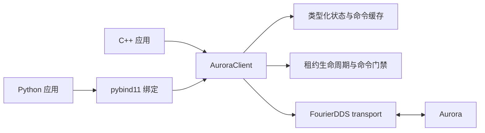

# SDK 总览与构建指南

[English](overview.md) · [快速开始](../README_CN.md) ·
[C++ API](cpp_api_CN.md) · [Python API](python_api_CN.md) ·
[示例与客户端](examples_and_clients_CN.md)

## SDK 提供什么

Fourier Aurora SDK 是一套实现、两种语言接口：

- 命名空间为 `fourier::aurora_sdk` 的 C++17 动态库；
- 通过 pybind11 绑定同一 C++ 核心的 Python 包 `fourier_aurora_client`。

高层 `AuroraClient` 负责创建 DDS endpoint、管理生命周期、缓存接收状态、调用
service、发布命令，以及管理模块控制租约。因此 C++ 与 Python 遵循相同的
生命周期和返回值模型。



生成的 DDS 类型与 transport 细节属于实现依赖。应用应包含
`aurora_client.hpp` 或导入 `fourier_aurora_client`，并使用 SDK 自有的命令、
状态、返回值和异常类型。

## 仓库结构

| 路径 | 用途 |
|---|---|
| `include/fourier_aurora_sdk/` | 安装给用户的 C++ 头文件和 SDK 自有类型 |
| `src/` | C++ client、租约管理和 FourierDDS transport 实现 |
| `python/bindings/` | C++ API 与数据类型的 pybind11 绑定 |
| `python/fourier_aurora_client/` | Python 风格的单例封装与 package export |
| `examples/client/` | 与机器人型号无关的 C++ 诊断客户端 |
| `examples/gr3/` | 独立的 C++/Python GR3 recipe |
| `tests/` | C++、Python、DDS loopback 与安装包测试 |
| `scripts/` | 构建、打包与验证入口 |
| `packaging/`、`cmake/` | Debian 与 CMake package 支持 |
| `docs/` | 中英文用户文档 |
| `VERSION`、`REVISIONS.yaml` | SDK 版本和兼容依赖版本 |

## 运行时设计

### 每个进程一个可重启 client

`AuroraClient` 是进程级单例。获取实例不会启动 DDS。应在 `Stopped` 状态完成
配置，调用 `start()` 后执行操作，并在退出前调用 `stop()`。停止后可以重新配置
并再次启动。

`config()` 返回配置副本，`configure()` 会替换整个配置。因此通常先复制当前
配置，只修改应用需要的字段，再写回完整对象。

### 按需创建 endpoint

`ConnectionOptions.enabled_endpoints` 决定创建哪些 DDS reader、writer 和
service。只选择需要的 endpoint 可以减少发现流量和资源占用。
`waitForEndpoints()` / `wait_for_endpoints()` 等待所有已启用 endpoint 匹配，
然后额外稳定 200 ms，等待 volatile topic 的首个 sample。

SDK 管理的上层接口 Topic 和 Service 名称使用
`ConnectionOptions.topic_prefix`，默认值为 `aurora/`，例如
`aurora/robot_motion_cmd` 和 `aurora/ManageLease`。如果 Aurora 配置为空前缀，
SDK 也应将该选项设置为空字符串。

所有 SDK client 都必须在 transport 启动前配置符合
`[A-Za-z0-9._-]{1,64}` 的 `source_name`。受保护的 publisher
（`MotionCommand`、`ControlGroupCommand` 和临时
`MotorConfigurationCommand`）还必须启用 `ManageLeaseService`。

### 状态快照与返回值

每个 subscriber 维护一份最新值缓存。Getter 返回完整快照，不会等待新 sample；
收到第一条 sample 之前返回 `STATE_NOT_RECEIVED`。

普通操作失败通过 `OperationResult {code, message}` 返回。C++ getter 失败时不会
修改输出参数；Python getter 返回 `(result, value)`。错误配置和生命周期误用会
抛出类型化 SDK 异常。Publish 成功仅表示本地 DDS 接受 sample，不是机器人执行
确认。

### 控制租约

一个模块（`source_name`）最多持有一个 SDK 管理的租约。应用注册第一组完整资源，
需要时原子替换资源，并在不再控制时释放。SDK 使用 steady clock 自动续租；如果
没有有效租约覆盖命令涉及的全部资源，会在本地拒绝受保护 publish。

默认租约周期为四秒，并在实际 grant 周期的四分之一处续租（默认一秒）。租约只
保存在内存中。Client 重启后应注册新租约。如果 Aurora 仍持有旧租约，
注册可能等待这个短租约过期，并在调用者设置的操作 timeout 内重试。

## 依赖

源码构建面向 Linux，并要求使用[兼容性清单](../REVISIONS.yaml)中的运行库版本：

| 依赖 | 当前 package 要求 | 用途 |
|---|---|---|
| CMake | 3.16 或更新 | 配置、构建、安装、打包 |
| C++ 编译器 | C++17 | 原生 SDK 与客户端 |
| `fourier_dds` | `1.2.0-1` | DDS transport 抽象 |
| `fourier-dds-msgs` | `0.2.0-1` | Aurora DDS 生成消息 |
| FastDDS/FastCDR | 随 DDS 包提供 | DDS runtime |
| Python | standard-GIL CPython 3.10–3.13 | Python client wheel |
| pybind11 | 2.13.6 或更新 | Python 原生绑定 |
| scikit-build-core、build | scikit-build-core 0.9.10 或更新，以及 build | Python 打包 |

从 SDK 分发方获取匹配的 `fourier_dds` 和 `fourier-dds-msgs` Debian 包。架构
必须与 SDK 一致（`amd64` 或 `arm64`），安装前使用分发方提供的 `SHA256SUMS`
核对文件：

```bash
cd /path/to/runtime-debs
sha256sum --check SHA256SUMS
sudo apt install ./*.deb
dpkg-query -W fourier_dds fourier-dds-msgs
```

Wheel 不捆绑这些原生依赖，pip 也不会安装它们。打包脚本要求环境已准备好，
不会修改 apt 源、安装系统包或下载构建工具。

依赖前缀中必须包含：

```text
<prefix>/lib/cmake/fourier_dds/
<prefix>/fourier_dds_msgs/include/fourier_dds_msgs/
<prefix>/fourier_dds_msgs/lib/
```

标准部署前缀是 `/opt/fftai`。不要混用不兼容的生成消息库、FourierDDS 或
FastDDS runtime。

## 从源码构建

以下命令假设依赖已经安装在 `/opt/fftai`。

### 原生开发构建

```bash
cmake -S . -B build \
  -DCMAKE_BUILD_TYPE=Release \
  -DFOURIER_AURORA_SDK_DDS_PREFIX=/opt/fftai
cmake --build build --parallel 4
```

原生构建默认启用 DDS、Python 绑定、诊断客户端和 C++ 示例，测试默认关闭。如果
当前 Python 环境没有 pybind11，可以安装 Python 构建依赖，或者只构建 C++：

```bash
cmake -S . -B build-cpp \
  -DCMAKE_BUILD_TYPE=Release \
  -DFOURIER_AURORA_SDK_DDS_PREFIX=/opt/fftai \
  -DFOURIER_AURORA_SDK_BUILD_PYTHON=OFF
cmake --build build-cpp --parallel 4
```

常用 CMake 开关：

| 选项 | 原生默认值 | 作用 |
|---|---:|---|
| `FOURIER_AURORA_SDK_BUILD_PYTHON` | `ON` | 构建 pybind11 extension |
| `FOURIER_AURORA_SDK_BUILD_CLIENT_TOOLS` | `ON` | 构建 `aurora-client` |
| `FOURIER_AURORA_SDK_INSTALL_SYSTEM_CLIENT` | `OFF` | 在系统路径暴露客户端和补全（打包用） |
| `FOURIER_AURORA_SDK_BUILD_EXAMPLES` | `ON` | 构建 C++ GR3 recipe |
| `FOURIER_AURORA_SDK_BUILD_TESTS` | `OFF` | 构建并注册测试 |
| `FOURIER_AURORA_SDK_ENABLE_DDS_TRANSPORT` | `ON` | 启用真实 transport |

### 安装原生构建

默认安装前缀是 `/opt/fftai/fourier_aurora_sdk`。安装到本地 staging 路径：

```bash
cmake --install build-cpp --prefix /tmp/fourier-aurora-sdk-install
```

安装结果：

```text
include/fourier_aurora_sdk/        C++ 头文件
lib/libfourier_aurora_sdk.so*      动态库
lib/cmake/fourier_aurora_sdk/      find_package 配置
bin/aurora-client                  统一诊断客户端
share/{bash-completion,zsh,fish}/  shell 自动补全
share/doc/fourier_aurora_sdk/      readme、license、changelog、GR3 源码
```

### 构建 Debian 包

打包脚本使用全新的临时构建目录，并打印最终 artifact 的精确路径：

```bash
FOURIER_AURORA_SDK_DDS_PREFIX=/opt/fftai \
ARTIFACT_ROOT=/tmp/aurora-sdk-artifacts \
./scripts/build_deb.sh
```

输出文件名为 `fourier-aurora-sdk_<version>_<arch>.deb`。确保系统能
获得匹配的 DDS package，再安装：

```bash
sudo apt install ./fourier-aurora-sdk_1.0.1*.deb
```

### 构建 Python wheel

x86_64 脚本每次构建一个解释器专用 wheel。通过 `PYTHON_BIN` 选择 CPython
3.10、3.11、3.12 或 3.13，并在对应环境安装 `build`、`pybind11` 与
`scikit-build-core`：

```bash
python3.10 -m pip install build 'pybind11>=2.13.6' 'scikit-build-core>=0.9.10'
FOURIER_AURORA_SDK_DDS_PREFIX=/opt/fftai \
ARTIFACT_ROOT=/tmp/aurora-sdk-artifacts \
PYTHON_BIN=python3.10 ./scripts/build_wheel_x86_64.sh
```

Wheel 包含 Python package、原生 binding 和私有 SDK 动态库，不包含头文件、
示例、客户端或测试。系统仍需提供兼容的 DDS 与消息 runtime 库。

### 批量构建安装包

在 `PATH` 中准备好选定的 `python3.x` 解释器、各自的开发头文件和上述 Python
构建依赖。默认构建 Python 3.10–3.13，也可以指定子集：

```bash
FOURIER_AURORA_SDK_PY_VERSIONS='3.10' \
FOURIER_AURORA_SDK_DDS_PREFIX=/opt/fftai \
OUTPUT_DIR=/tmp/aurora-sdk-distribution \
JOBS=4 bash scripts/build_packages.sh
```

每次构建使用新的临时目录，检查源码包，并将源码包、DEB 和 wheel 复制到 `OUTPUT_DIR`（默认
`dist/`），不删除已有输出文件。默认生成不含提交号的发布包名；开发构建可从
干净的 Git checkout 显式设置 `INCLUDE_COMMIT_HASH=ON`。

交叉编译 arm64 时还需设置 `ARCH=arm64`、`SYSROOT`、
`CMAKE_TOOLCHAIN_FILE` 和 `TARGET_PYTHON_VERSION`。Sysroot 必须包含 arm64
DDS 包和匹配的 Python 头文件；宿主 Python 版本必须与目标 Python 版本一致。
运行时验证应在 arm64 系统上执行。

### 验证源码包和安装包

```bash
python3 -m build --sdist --outdir /tmp/aurora-sdk-source
python3 scripts/check_source_package.py \
  /tmp/aurora-sdk-source/fourier_aurora_client-1.0.1.tar.gz
bash scripts/check_version_consistency.sh
bash scripts/check_wheel_package.sh /path/to/fourier_aurora_client-1.0.1-cp310-cp310-linux_x86_64.whl
FOURIER_AURORA_SDK_DDS_PREFIX=/opt/fftai \
  bash scripts/check_deb_package.sh /path/to/fourier-aurora-sdk_1.0.1_amd64.deb
```

原生库和 Python 测试需要 `pytest` 与 `pybind11`，运行
`JOBS=4 bash scripts/test_debug.sh` 或 `scripts/test_release.sh` 即可。这两个
profile 使用 mock transport。设置 `FOURIER_AURORA_SDK_DDS_PREFIX` 后运行
`scripts/test_dds_transport.sh` 可以验证真实 DDS loopback。交付包默认关闭测试。

## 使用构建结果

### CMake 应用

SDK 安装在标准前缀时，CMake 通常可以直接找到。使用自定义前缀时：

```bash
cmake -S app -B app/build \
  -DCMAKE_PREFIX_PATH=/tmp/fourier-aurora-sdk-install
```

```cmake
find_package(fourier_aurora_sdk 1.0 CONFIG REQUIRED)
add_executable(app main.cpp)
target_link_libraries(app PRIVATE fourier_aurora_sdk::fourier_aurora_sdk)
target_compile_features(app PRIVATE cxx_std_17)
```

### Python 应用

```bash
python3 -m pip install /path/to/fourier_aurora_client-1.0.1-*.whl
python3 -c 'import fourier_aurora_client; print("Aurora SDK ready")'
```

## 实现一个应用

C++ 与 Python 都按以下顺序使用：

1. 获取单例并复制 `ConnectionOptions`。
2. 设置可读 `source_name`、DDS domain/namespace，并选择最小 endpoint 集合。
3. 需要受保护命令时，启用
   `ManageLeaseService` 和对应 publisher。
4. 只在 stopped 状态配置 callback，然后启动 client。
5. 等待 endpoint 匹配，并单独确认机器人/FSM 是否可执行操作。
6. 读取快照并检查每个 `OperationResult`。
7. 发送受保护命令前注册租约，并检查 `LeaseResult.usable()`。
8. 完成控制后释放租约，并始终调用 `stop()`。

继续阅读 [C++ API](cpp_api_CN.md)、[Python API](python_api_CN.md)以及
[示例与诊断客户端](examples_and_clients_CN.md)。
